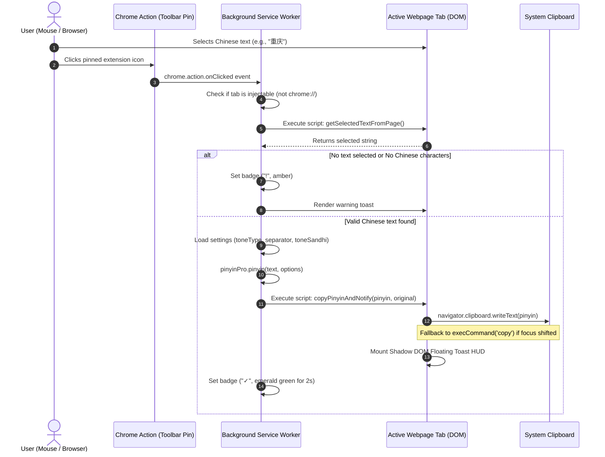

# Functional & Technical Specification: Chinese Pinyin Copier

**Document Version:** 1.0.0  
**Target Platform:** Google Chrome (Manifest V3)  
**Primary Interaction:** Pinned Action Icon Click (`chrome.action.onClicked`)

---

## 1. Executive Summary

The **Chinese Pinyin Copier** is a Google Chrome extension engineered for language learners, translators, and researchers. Its primary functionality is activated when the user clicks the pinned extension icon in the Chrome toolbar. 

If Chinese characters are selected on the active webpage, the extension extracts the text, accurately converts it into Mandarin Pinyin (including diacritic tone marks and context-aware polyphonic disambiguation), writes the result directly to the system clipboard, and presents a sleek in-page confirmation HUD.

---

## 2. Core User Story & Acceptance Criteria

### User Story
> *As a user reading or studying Chinese on the web,*  
> *I want to highlight any Chinese word or sentence with my mouse and click the pinned extension button in my browser toolbar,*  
> *So that the accurate Pinyin representation is instantly copied to my clipboard without opening disruptive popups or navigating away.*

### Acceptance Criteria
1. **Pinned Toolbar Trigger:** Clicking the pinned toolbar icon executes the conversion immediately without opening a popup dialog.
2. **Selection Detection:** Successfully extracts selected text from normal page elements as well as text selected within `<input>` and `<textarea>` elements.
3. **Chinese Character Filtering:** Identifies and verifies the presence of Unicode CJK Han characters (`\p{Script=Han}` / `[\u4e00-\u9fa5]`).
4. **Pinyin Conversion:** Converts Chinese characters to Pinyin using the accurate, offline `pinyin-pro` dictionary engine. Polyphonic words (多音字, e.g. 银行 *yín háng* vs 行走 *xíng zǒu*) must be contextually resolved.
5. **Clipboard Delivery:** The converted Pinyin string is written to the system clipboard immediately.
6. **Visual Confirmation:** 
   - Displays a non-intrusive floating toast notification on the active page showing the original text and its Pinyin equivalent.
   - Updates the pinned extension badge with a temporary confirmation indicator (`✓` for success, `!` for warning, `ERR` for restricted tab).
7. **Negative Flow Feedback:** If no text is selected or the selected text contains no Chinese characters, an informative warning toast and badge indicator are shown.
8. **Google Sheets & Tabular Range Support:** When selecting multi-cell ranges in Google Sheets or HTML tables, accurately converts Chinese cells to Pinyin while preserving non-Chinese cells, dimensions, and grid coordinates. Delivers dual-MIME payload (`text/plain` TSV + `text/html` table) for seamless paste-back.
9. **Word-Level Grouping (分词连写):** In accordance with Chinese Pinyin Orthography standards (GB/T 16159-2012), groups characters belonging to the same lexical word together without intra-word spaces (e.g. `洗手间在哪里` → `xǐshǒujiān zài nǎlǐ`, `你会说英文吗?` → `nǐ huì shuō yīngwén ma?`, `可以用支付宝吗?` → `kěyǐ yòng zhīfùbǎo ma?`), with proper brand preservation, modal verb splitting, and punctuation attachment.
10. **Erhua (儿化) Support:** Automatically merges Erhua suffixes (`一点儿` → `diar`, `玩儿` → `war`) according to user configuration (Phonetic contraction, National standard orthography, or Off), while rigorously distinguishing independent non-Erhua morphemes (`婴儿`, `儿童`, `孤儿`, `托儿所`).
11. **Configurability:** Users can adjust tone styles (marks, numbers, tone-less), word grouping mode, syllable separators, tone sandhi, Erhua mode, and toast preferences via the extension settings.

---

## 3. Architecture & Data Flow



---

## 4. Technical Component Breakdown

### 4.1 Manifest V3 Configuration (`manifest.json`)
- **No `default_popup`:** By omitting `default_popup` inside the `"action"` manifest definition, Chrome directs all toolbar pin clicks directly to `chrome.action.onClicked` inside the background service worker.
- **Permissions:**
  - `activeTab`: Provides temporary script execution privileges on the currently active tab when the action is triggered.
  - `scripting`: Enables programmatic script execution (`chrome.scripting.executeScript`).
  - `clipboardWrite`: Grants authorization to modify the system clipboard.
  - `storage`: Preserves user configuration across browser sessions.

### 4.2 Background Service Worker (`background.js`)
- Runs as an event-driven background service worker.
- Preloads `lib/pinyin-pro.js` via `importScripts()` so dictionary lookups execute locally at near-instantaneous speed (<2ms).
- Validates the target tab against restricted internal URLs (`chrome://`, `edge://`, `chrome-extension://`, Chrome Web Store) where Chrome security policies disallow script injection.

### 4.3 Content-Level Script Execution & Clipboard API
- **Focus-Resistant Clipboard Copying:**
  When clicking a browser action icon in the Chrome toolbar, document focus momentarily transfers from the webpage to the browser chrome. Calling `navigator.clipboard.writeText()` under these conditions can reject with a `Document is not focused` DOMException.
  To guarantee 100% reliability, the implementation executes a two-tier strategy:
  1. Primary: `navigator.clipboard.writeText(pinyinText)`
  2. Fallback: Creates an off-screen `<textarea>`, transfers focus, and invokes `document.execCommand('copy')`.
- **CSS Isolation via Shadow DOM:**
  The in-page floating toast is attached using a dedicated Web Component host with an open Shadow Root (`host.attachShadow({ mode: 'open' })`). This shields the notification's appearance from the host webpage's cascading stylesheets and prevents extension styles from polluting the page.

### 4.4 Options & Preferences (`options.html`, `options.css`, `options.js`)
Accessible via right-clicking the pinned icon and choosing "Options":
- **Tone Accent Style:**
  - `symbol` (*Default*): Pīnyīn with diacritical marks (`nǐ hǎo`).
  - `num`: Tone numbers at syllable end (`ni3 hao3`).
  - `none`: Syllables without tonal marks (`ni hao`).
- **Syllable Separator:** Space (` `), Hyphen (`-`), or None (``).
- **Tone Sandhi (变调):** Toggles automated 3rd-tone shift calculations and *bù* / *yī* pronunciation shifts.
- **Notification Toast:** Toggle switch and display duration options (1.5s to 5.0s).
- **Interactive Sandbox:** Live input field demonstrating instantaneous conversion according to selected settings.

### 4.5 Google Sheets & Tabular Range Architecture
Google Sheets renders grid cells dynamically via an HTML5 `<canvas>` element and does not support standard DOM text selection (`window.getSelection()`). To support row/column range selections in Google Sheets:
1. **Target Interception:** The extension identifies Google Sheets tabs (`docs.google.com/spreadsheets`) and focuses Google Sheets' active event target element (`iframe.docs-texteventtarget-iframe` or `.cell-input`).
2. **Native Copy Dispatch:** Dispatches `document.execCommand('copy')` to prompt Google Sheets' internal copy handler to populate the clipboard with the selected range's Tab-Separated Values (TSV).
3. **`clipboardRead` Permission:** Using the declared `"clipboardRead"` permission, reads the copied TSV from the clipboard.
4. **RFC-Compliant TSV Parsing:** Parses the raw TSV into a 2D matrix (`string[][]`), properly handling quoted fields containing embedded tabs, newlines, and escaped quotes (`""`).
5. **Cell-Level Selective Conversion:** Each cell is processed independently:
   - Cells containing Chinese characters are converted to Pinyin according to the user's settings.
   - Non-Chinese cells (empty cells, numbers, English labels, formulas, symbols) remain completely unmodified.
   - 2D grid dimensions, row alignment, and column positioning are strictly preserved.
6. **Dual-MIME Clipboard Delivery:** Writes both `text/plain` (TSV) and `text/html` (HTML `<table>` markup) via `navigator.clipboard.write([new ClipboardItem(...)])`. This guarantees that pasting into Google Sheets, Microsoft Excel, Apple Numbers, or plain text editors restores the exact cells without merging or layout distortion.
7. **Enhanced Toast HUD:** For multi-cell ranges, the floating toast HUD displays precise grid dimension feedback (e.g. `Pinyin Copied! (3 rows × 4 columns - 12 cells)` with preview).

---

## 5. Edge Cases & Error Handling Matrix

| Scenario | System Behavior | User Feedback |
| :--- | :--- | :--- |
| **No text highlighted** | Action intercepted | Amber badge (`!`) + Toast: *"Highlight Chinese text with your mouse first."* |
| **Selection contains only non-Chinese** (e.g. English, numbers) | Regex check fails | Amber badge (`!`) + Toast: *"The selected text does not contain Chinese characters."* |
| **Mixed text** (e.g. "Hello 你好 World") | Chinese converted; Latin/punctuation retained naturally | Emerald badge (`✓`) + Toast showing converted pinyin for Chinese segments |
| **Selection inside `<input>` or `<textarea>`** | Extracted via active element `selectionStart`/`selectionEnd` | Emerald badge (`✓`) + Pinyin copied to clipboard |
| **Google Sheets cell range selected** | Triggered via event target focus + `execCommand('copy')` + TSV parsing | Emerald badge (`✓`) + Toast: *"Pinyin Copied! (N rows × M columns)"* + dual TSV/HTML in clipboard |
| **Google Sheets range with no Chinese** | Matrix parsed, Chinese detection finds 0 Chinese cells | Amber badge (`!`) + Toast: *"The selected cells do not contain Chinese characters."* |
| **HTML table multi-cell selection** | Parsed via TSV tab-delimited parser | Emerald badge (`✓`) + Toast: *"Pinyin Copied! (N rows × M columns)"* + dual TSV/HTML in clipboard |
| **Restricted browser pages** (`chrome://settings`, etc.) | Injection prevented | Red badge (`ERR`) + warning logged in console |
| **Tab closed during execution** | Handled by `try/catch` | Fails gracefully without dangling promises |

---

## 6. Project File Structure

```text
ChineseExtension/
├── manifest.json              # Manifest V3 extension configuration (with clipboardRead)
├── background.js              # Service worker handling toolbar clicks, Google Sheets range conversion, & clipboard
├── options.html               # Options UI page
├── options.css                # Styling for settings page
├── options.js                 # Options controller & live sandbox preview
├── lib/
│   ├── erhua.js               # Phonological Erhua contraction engine & lexical exception lexicon
│   ├── segmenter.js           # Lexical word segmentation engine (GB/T 16159-2012 word grouping)
│   └── pinyin-pro.js          # Bundled offline Pinyin conversion dictionary (v3.29.5)
├── icons/
│   ├── icon16.png             # Toolbar 16x16 icon
│   ├── icon32.png             # Windows high-DPI 32x32 icon
│   ├── icon48.png             # Extensions management 48x48 icon
│   ├── icon128.png            # Web Store & install 128x128 icon
│   └── *.svg                  # Source vector graphics
├── scripts/
│   └── generate-icons.sh      # SVG-to-PNG asset generator
├── test/
│   ├── test-page.html         # Interactive HTML test harness with Spreadsheet simulation & paste inspector
│   └── unit-test.js           # Automated test suite (Manifest, Regex, TSV parser, Matrix converter, HTML table)
├── SPECIFICATION.md           # This specification document
├── package.json               # Project metadata & npm test scripts
└── README.md                  # Quick-start installation & usage guide
```

---

## 7. Verification & Testing Procedure

### Manual Verification
1. Open Google Chrome and navigate to `chrome://extensions`.
2. Enable **Developer mode** (toggle in the upper right corner).
3. Click **Load unpacked** and select the `/ChineseExtension` directory.
4. Locate the extension in the extensions list and **pin its icon** to the Chrome toolbar (click the puzzle piece icon, then click the pin icon next to "Chinese Pinyin Copier").
5. **Google Sheets Range Test:**
   - Open a sheet on `https://docs.google.com/spreadsheets/`.
   - Enter a 3×3 grid of Chinese text (e.g. `北京`, `上海`, `广州`).
   - Select the cells with mouse/keyboard and click the pinned extension button.
   - Observe the toast confirmation HUD: `Pinyin Copied! (3 rows × 3 columns)`.
   - Paste (`Cmd+V` / `Ctrl+V`) into a blank sheet area; verify all 9 cells align perfectly in their respective rows and columns.
6. **Local Table Test Harness:**
   - Open `test/test-page.html` in Chrome.
   - In Section 5 ("Spreadsheet & Tabular Data Simulation"), select multiple cells across the table.
   - Click the pinned icon; verify dimension HUD.
   - Paste into the Multi-Cell Paste Inspector to verify 2D structure.

### Automated Test Suite
Run the automated test runner in the terminal:
```bash
npm test
```
The test suite validates:
- Manifest V3 compliance and correct permission configuration (`clipboardRead`, `clipboardWrite`, `activeTab`, `scripting`).
- CJK Unicode regex pattern matching across all edge cases.
- Pinyin conversion accuracy across tone symbols, numbers, and custom separators.
- Polyphonic context disambiguation (多音字).
- RFC-compliant TSV parsing (embedded quotes, newlines, tabs) and round-trip serialization.
- 2D matrix Pinyin conversion (preserving non-Chinese cells, empty cells, and coordinate alignment).
- HTML table generation with safe character escaping.
- Tabular data detection across Google Sheets and standard web pages.
- Icon asset integrity.

